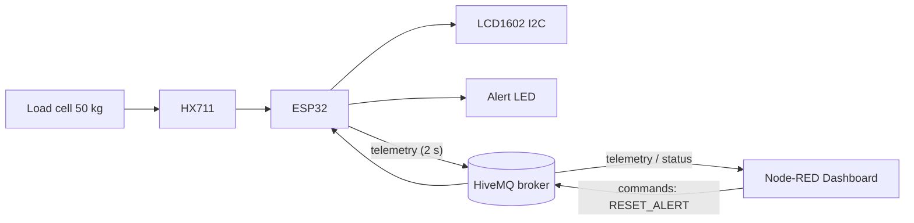

# Smart Shelf Inventory Alert System

A smart shelf system built with an **ESP32 + HX711 load cell**, displaying stock levels on an **LCD1602 I2C**, warning via **LED**, transmitting data over **MQTT**, and monitored through a **Node-RED dashboard**.

> **Wokwi simulation:** https://wokwi.com/projects/476182207362545665

## 1. Key Features

- Measures the weight of goods on the shelf with a 50 kg load cell + HX711, using a **5-sample median filter** to reduce noise.
- Converts weight → item count (default **330 g per item**).
- Status classification:
  - `OK` — normal stock level.
  - `LOW_STOCK` — fewer than 3 items remaining.
  - `ERR:OBJECT` — weight deviates by more than ±50 g from a multiple of 330 g (foreign object / wrong item type).
- Displays weight, quantity, and status on the LCD1602 (I2C).
- Red LED alert on `LOW_STOCK` or `ERR:OBJECT`.
- Publishes MQTT telemetry every 2 seconds; uses **Last Will & Testament** to report `OFFLINE` when the connection drops.
- Accepts the `RESET_ALERT` command from Node-RED to suppress the LED alert for 10 seconds.
- Automatic zero-point correction (auto-zero) when the scale drifts slightly for 10 seconds; the tare offset is stored in Flash (NVS) and reused after reboot.
- Node-RED dashboard: weight gauge, quantity gauge, history chart, ONLINE/OFFLINE connection status, and an alert reset button.

## 2. System Architecture



## 3. Hardware and Wiring

| Component | Pin | ESP32 |
|---|---|---|
| HX711 | `DT` | GPIO 4 |
| HX711 | `SCK` | GPIO 5 |
| HX711 | `VCC` / `GND` | 5V / GND |
| LCD1602 I2C | `SDA` | GPIO 21 |
| LCD1602 I2C | `SCL` | GPIO 22 |
| LCD1602 I2C | `VCC` / `GND` | 5V / GND |
| Red LED | Anode (via 220 Ω resistor) | GPIO 15 |
| Red LED | Cathode | GND |

> The full simulation schematic is available in [`diagram.json`](diagram.json).

## 4. MQTT Protocol

- Broker: `broker.hivemq.com`, port `1883` (public, no TLS — **demo use only**).
- Device ID: `shelf_01`.

| Topic | Direction | Retain | Interval |
|---|---|---|---|
| `smartretail/shelves/shelf_01/telemetry` | ESP32 → Node-RED | No | 2 s |
| `smartretail/shelves/shelf_01/status` | ESP32 → Node-RED (LWT: `OFFLINE`) | Yes | On connect / disconnect |
| `smartretail/shelves/shelf_01/commands` | Node-RED → ESP32 | No | When the RESET button is pressed |

**Telemetry**

```json
{
  "device_id": "shelf_01",
  "weight_g": 990,
  "quantity": 3,
  "alert_status": "OK"
}
```

**Status (Last Will & Testament)**

```json
{ "device_id": "shelf_01", "connection": "ONLINE" }
```

```json
{ "device_id": "shelf_01", "connection": "OFFLINE" }
```

**Command**

```json
{ "command": "RESET_ALERT" }
```

## 5. ESP32 Processing Algorithm

1. Read 5 samples with `scale.get_units(1)`, sort them, and take the **median**.
2. If |weight| stays within (0.5 g, 50 g] for 10 seconds → `tare()` (only when the shelf is nearly empty).
3. Noise rejection: weights ≤ 50 g are treated as 0 g.
4. Compute `quantity = round(weight / 330)` and `expected = quantity × 330`.
   - If `weight > 0` and `|weight − expected| > 50 g` → `ERR:OBJECT`.
   - Otherwise, if `quantity < 3` → `LOW_STOCK`.
5. Turn the LED on when there is an alert, unless within 10 seconds after the `RESET_ALERT` command.
6. Publish MQTT telemetry and update the LCD every 2 seconds.

## 6. Project Structure

```text
.
├── sketch.ino                       # ESP32 firmware
├── diagram.json                     # Wokwi circuit schematic
├── libraries.txt                    # Wokwi libraries to install
├── nodered/
│   └── smart-shelf-dashboard.json   # Node-RED flow (dashboard)
├── README.md
├── .gitignore
└── wokwi-project.txt                # Wokwi project metadata (can be deleted)
```

## 7. Running the Wokwi Simulation

1. Open the [Wokwi project](https://wokwi.com/projects/476182207362545665) or create a new project and **Import from GitHub** this repository.
2. Click ▶ to start the simulation and open the **Serial Monitor** (115200 baud).
3. Change the HX711 weight to simulate adding/removing goods:
   - In the simulator: use the HX711 `load` slider (if available).
   - Use an Automation Scenario with the `load` control (unit: **kg**), e.g. `0.99` kg ≈ 3 items.
4. Observe the LCD, LED, and MQTT data in the Serial Monitor.

## 8. Node-RED Dashboard

**Requirements:** Node.js LTS, Node-RED 3.x/4.x, and the `node-red-dashboard` package (classic dashboard).

Installation:

```bash
npm install -g node-red
cd ~/.node-red
npm install node-red-dashboard
node-red
```

Then:

1. Open `http://localhost:1880`.
2. Menu ☰ → **Import** → select `nodered/smart-shelf-dashboard.json` → **Import** → **Deploy**.
3. Open the dashboard at `http://localhost:1880/ui`.

The dashboard includes:

- **Device status:** ONLINE/OFFLINE badge (from the `status` topic, LWT-enabled).
- **Inventory:** weight gauge (0–2000 g), quantity gauge (0–10), status line `quantity · alert · time`.
- **Weight history:** line chart of the last 10 minutes.
- **Controls:** the `RESET ALERT` button publishes `{"command":"RESET_ALERT"}` to the `commands` topic.

> The MQTT broker is preconfigured as `broker.hivemq.com:1883`. If you change the topic prefix in the firmware, update the three MQTT nodes in the flow accordingly.

## 9. Calibrating the Load Cell with Real Hardware

The value `calibration_factor = 0.42` is only valid for the Wokwi simulation. When using a real load cell:

1. Flash the firmware and open the Serial Monitor (115200 baud).
2. Keep the shelf empty and call `tare()` (the firmware tares automatically on first boot) to set the zero point.
3. Place a known mass (e.g. 1000 g) on the shelf and read `scale.get_value(10)` after taring.
4. Calculate: `calibration_factor = get_value(10) / actual_mass (g)`.
5. Update the constant in `sketch.ino` and force a re-tare: rename the NVS key (e.g. `offset` → `offset_v2`) or call `preferences.clear()` once, then reflash the firmware.
6. Verify at several load levels; target error ±50 g.

## 10. Configuration Parameters

| Constant | Value | Description |
|---|---|---|
| `WEIGHT_PER_ITEM` | 330 g | Weight of one item |
| `MIN_STOCK_LEVEL` | 3 | Alert when quantity < 3 |
| `TOLERANCE` | 50 g | Noise / weight-error threshold |
| `MEASURE_INTERVAL` | 2000 ms | Measurement and MQTT publish interval |
| `AUTO_ZERO_TIME` | 10000 ms | Time required to confirm zero drift |
| `RESET_HOLD_TIME` | 10000 ms | LED suppression time after `RESET_ALERT` |
| `calibration_factor` | 0.42 | Calibration factor (Wokwi) |

## 11. Deployment Notes

- The HiveMQ public broker has **no authentication or encryption** — for learning/demo use only. For real deployments, use a private broker with TLS and credentials.
- Consider changing the topic prefix `smartretail/shelves/shelf_01` to a team-specific prefix to avoid collisions on the public broker (remember to update both the firmware and Node-RED).
- Do not commit Wi-Fi credentials / passwords / private broker details. Use a `secrets.h` file (already listed in `.gitignore`).
- A 50 kg load cell requires rigid mechanical mounting; avoid off-axis forces and overload.

## 12. Team

| Member | Role |
|---|---|
| Phạm Công Phú Quí | ESP32 / Wokwi / firmware |
| Team member | Node-RED dashboard / MQTT integration |
