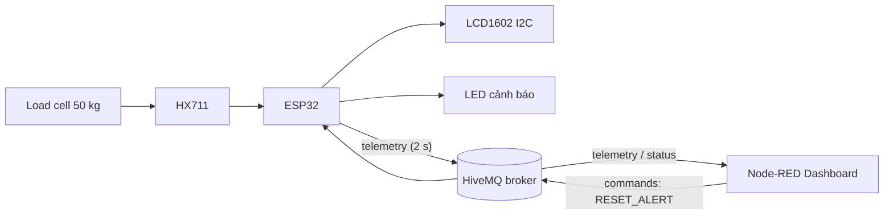

# Kệ hàng thông minh báo tồn kho

**Đề tài 41** — Hệ thống kệ hàng thông minh dùng **ESP32 + load cell HX711**, hiển thị tồn kho trên **LCD1602 I2C**, cảnh báo bằng **LED**, truyền dữ liệu qua **MQTT** và giám sát trực quan trên **dashboard Node-RED**.

> **Mô phỏng Wokwi:** https://wokwi.com/projects/476182207362545665

## 1. Tính năng chính

- Đo khối lượng hàng trên kệ bằng load cell 50 kg + HX711, lọc **trung vị 5 mẫu** để giảm nhiễu.
- Quy đổi khối lượng → số lượng sản phẩm (mặc định **330 g/sản phẩm**).
- Phân loại trạng thái:
  - `OK` — tồn kho bình thường.
  - `LOW_STOCK` — số lượng còn dưới 3 sản phẩm.
  - `ERR:OBJECT` — khối lượng lệch quá ±50 g so với bội số 330 g (có vật lạ / hàng sai loại).
- Hiển thị khối lượng, số lượng và trạng thái trên LCD1602 (I2C).
- LED đỏ cảnh báo khi `LOW_STOCK` hoặc `ERR:OBJECT`.
- Gửi telemetry MQTT mỗi 2 giây; dùng **Last Will & Testament** để báo `OFFLINE` khi mất kết nối.
- Nhận lệnh `RESET_ALERT` từ Node-RED để tắt LED cảnh báo trong 10 giây.
- Tự động hiệu chỉnh điểm 0 (auto-zero) khi cân trôi nhẹ trong 10 giây; offset tare được lưu vào Flash (NVS) để dùng lại sau khi khởi động.
- Dashboard Node-RED: gauge khối lượng, gauge số lượng, biểu đồ lịch sử, trạng thái kết nối ONLINE/OFFLINE và nút reset cảnh báo.

## 2. Kiến trúc hệ thống



## 3. Phần cứng và đấu nối

| Linh kiện | Chân | ESP32 |
|---|---|---|
| HX711 | `DT` | GPIO 4 |
| HX711 | `SCK` | GPIO 5 |
| HX711 | `VCC` / `GND` | 5V / GND |
| LCD1602 I2C | `SDA` | GPIO 21 |
| LCD1602 I2C | `SCL` | GPIO 22 |
| LCD1602 I2C | `VCC` / `GND` | 5V / GND |
| LED đỏ | Anode (qua trở 220 Ω) | GPIO 15 |
| LED đỏ | Cathode | GND |

> Sơ đồ mô phỏng đầy đủ nằm trong [`diagram.json`](diagram.json).

## 4. Giao thức MQTT

- Broker: `broker.hivemq.com`, cổng `1883` (public, không TLS — **chỉ dùng cho demo**).
- Device ID: `shelf_01`.

| Topic | Chiều | Retain | Chu kỳ |
|---|---|---|---|
| `smartretail/shelves/shelf_01/telemetry` | ESP32 → Node-RED | Không | 2 s |
| `smartretail/shelves/shelf_01/status` | ESP32 → Node-RED (LWT: `OFFLINE`) | Có | Khi kết nối / mất kết nối |
| `smartretail/shelves/shelf_01/commands` | Node-RED → ESP32 | Không | Khi bấm nút RESET |

**Telemetry**

```json
{
  "device_id": "shelf_01",
  "weight_g": 990,
  "quantity": 3,
  "alert_status": "OK"
}
```

**Status (Last Will & Testament)**

```json
{ "device_id": "shelf_01", "connection": "ONLINE" }
```

```json
{ "device_id": "shelf_01", "connection": "OFFLINE" }
```

**Command**

```json
{ "command": "RESET_ALERT" }
```

## 5. Thuật toán xử lý trên ESP32

1. Đọc 5 mẫu `scale.get_units(1)`, sắp xếp và lấy **trung vị**.
2. Nếu |khối lượng| nằm trong khoảng (0,5 g; 50 g] liên tục 10 giây → `tare()` (chỉ khi kệ gần như trống).
3. Khử nhiễu: khối lượng ≤ 50 g được coi là 0 g.
4. Tính `quantity = round(weight / 330)` và `expected = quantity × 330`.
   - Nếu `weight > 0` và `|weight − expected| > 50 g` → `ERR:OBJECT`.
   - Ngược lại nếu `quantity < 3` → `LOW_STOCK`.
5. Bật LED khi có cảnh báo, trừ khi đang trong 10 giây sau lệnh `RESET_ALERT`.
6. Gửi telemetry MQTT và cập nhật LCD mỗi 2 giây.

## 6. Cấu trúc thư mục

```text
.
├── sketch.ino                       # Firmware ESP32
├── diagram.json                     # Sơ đồ mạch Wokwi
├── libraries.txt                    # Thư viện Wokwi cần cài
├── nodered/
│   └── smart-shelf-dashboard.json   # Flow Node-RED (dashboard)
├── README.md
├── .gitignore
└── wokwi-project.txt                # Metadata dự án Wokwi (có thể xóa)
```

## 7. Chạy mô phỏng trên Wokwi

1. Mở [dự án Wokwi](https://wokwi.com/projects/476182207362545665) hoặc tạo project mới và **Import from GitHub** repo này.
2. Bấm nút ▶ để chạy mô phỏng, mở **Serial Monitor** (115200 baud).
3. Thay đổi khối lượng trên HX711 để mô phỏng thêm/bớt hàng:
   - Trên trình mô phỏng: dùng thanh trượt `load` của linh kiện HX711 (nếu có).
   - Dùng Automation Scenario với control `load` (đơn vị **kg**), ví dụ `0.99` kg ≈ 3 sản phẩm.
4. Quan sát LCD, LED và dữ liệu MQTT trên Serial Monitor.

## 8. Dashboard Node-RED

**Yêu cầu:** Node.js LTS, Node-RED 3.x/4.x và package `node-red-dashboard` (dashboard cổ điển).

Cài đặt:

```bash
npm install -g node-red
cd ~/.node-red
npm install node-red-dashboard
node-red
```

Sau đó:

1. Mở `http://localhost:1880`.
2. Menu ☰ → **Import** → chọn `nodered/smart-shelf-dashboard.json` → **Import** → **Deploy**.
3. Mở dashboard tại `http://localhost:1880/ui`.

Dashboard gồm:

- **Trạng thái thiết bị:** badge ONLINE/OFFLINE (lấy từ topic `status`, có LWT).
- **Tồn kho:** gauge khối lượng (0–2000 g), gauge số lượng (0–10), dòng trạng thái `số lượng · cảnh báo · thời gian`.
- **Lịch sử khối lượng:** biểu đồ line 10 phút gần nhất.
- **Điều khiển:** nút `RESET CẢNH BÁO` gửi `{"command":"RESET_ALERT"}` tới topic `commands`.

> Broker MQTT được cấu hình sẵn là `broker.hivemq.com:1883`. Nếu đổi tiền tố topic trong firmware, cập nhật lại 3 node MQTT trong flow.

## 9. Hiệu chuẩn load cell với phần cứng thật

Hệ số `calibration_factor = 0.42` chỉ đúng với mô phỏng Wokwi. Khi lắp load cell thật:

1. Nạp firmware, mở Serial Monitor (115200 baud).
2. Để kệ trống, gọi `tare()` (firmware tự tare ở lần khởi động đầu) để đưa về 0 g.
3. Đặt vật có khối lượng đã biết (ví dụ 1000 g) lên kệ, đọc giá trị `scale.get_value(10)` sau khi tare.
4. Tính: `calibration_factor = get_value(10) / khối lượng_thật (g)`.
5. Cập nhật hằng số trong `sketch.ino` và buộc tare lại: đổi tên khóa NVS (ví dụ `offset` → `offset_v2`) hoặc gọi `preferences.clear()` một lần, rồi nạp lại firmware.
6. Kiểm tra lại với nhiều mức tải khác nhau; sai số mục tiêu ±50 g.

## 10. Thông số cấu hình

| Hằng số | Giá trị | Ý nghĩa |
|---|---|---|
| `WEIGHT_PER_ITEM` | 330 g | Khối lượng 1 sản phẩm |
| `MIN_STOCK_LEVEL` | 3 | Cảnh báo khi số lượng < 3 |
| `TOLERANCE` | 50 g | Ngưỡng nhiễu / sai số khối lượng |
| `MEASURE_INTERVAL` | 2000 ms | Chu kỳ đo và gửi MQTT |
| `AUTO_ZERO_TIME` | 10000 ms | Thời gian xác nhận trôi điểm 0 |
| `RESET_HOLD_TIME` | 10000 ms | Thời gian tắt LED sau `RESET_ALERT` |
| `calibration_factor` | 0.42 | Hệ số hiệu chuẩn (Wokwi) |

## 11. Lưu ý khi triển khai

- HiveMQ public broker **không có xác thực và mã hóa** — chỉ dùng cho học tập/demo. Khi triển khai thật, dùng broker riêng có TLS và tài khoản.
- Nên đổi tiền tố topic `smartretail/shelves/shelf_01` thành tiền tố riêng của nhóm để tránh trùng lặp trên broker công cộng (nhớ cập nhật cả firmware và Node-RED).
- Không commit thông tin Wi-Fi / mật khẩu / broker riêng tư. Dùng file `secrets.h` (đã có trong `.gitignore`).
- Load cell 50 kg cần gá lắp cơ khí chắc chắn; tránh lực lệch trục và quá tải.

## 12. Nhóm thực hiện

| Thành viên | Vai trò |
|---|---|
| Phạm Công Phú Quí | ESP32 / Wokwi / firmware |
| Thành viên nhóm | Node-RED dashboard / tích hợp MQTT |
